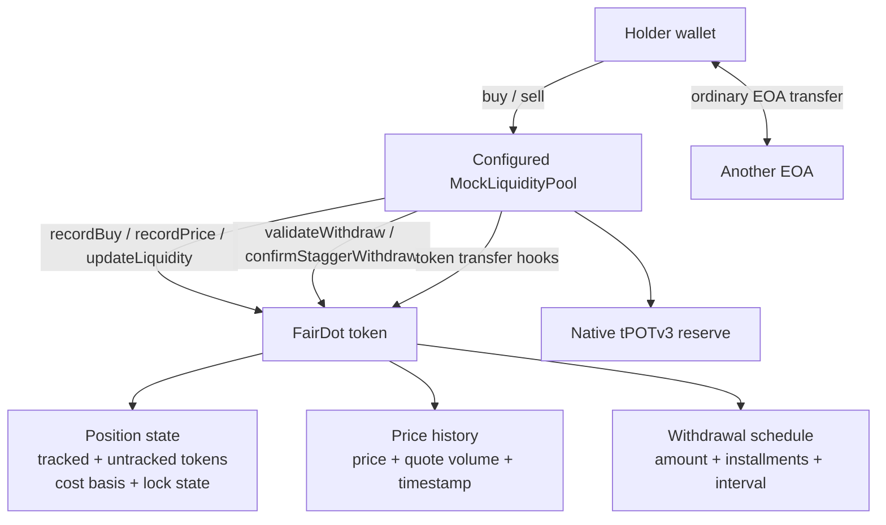

# FairDot — Architecture & Transaction Flows

## 1. System overview

FairDot consists of an ERC-20 token contract and one configured market contract. The included `MockLiquidityPool` uses native `tPOTv3` as its quote asset and demonstrates the integration hooks expected by the token contract. Wallets interact with the pool; the pool records buys, price observations, and quote reserves in FairDot.



## 2. Contract responsibilities

### `FairDot.sol`

- ERC-20 token with an initial supply of 1 billion `FAIR` in the deployment script.
- Tracks per-wallet `totalInvested`, `trackedTokens`, average entry price, and active lock state.
- Keeps `untrackedTokens` separate from tokens acquired through a pool-recorded buy.
- Accepts buy, price, liquidity, and stagger-completion hooks only from the configured pool, except `activateLock`, which is permissionless.
- Computes the recent quote-volume-weighted price and withdrawal eligibility.
- Requires the pool to be configured, seeded, and minting disabled before the owner can enable trading.
- Allows ordinary wallet-to-wallet transfers while carrying position accounting proportionally; blocks unsupported contract-market routes.

### `MockLiquidityPool.sol`

- Demonstration constant-product pool for `FAIR` and native `tPOTv3`.
- Allows its deployer/owner to add the initial liquidity once.
- Updates the token’s recorded quote reserve after seeding and swaps.
- Records buy/sell price observations and invokes the token’s accounting/withdrawal hooks.
- Contains no swap fee and no production-grade oracle, liquidity-management, or market-integration layer.

## 3. State model

| State | Location | Purpose |
| --- | --- | --- |
| `avgEntryPrice` | `FairDot.positions[wallet]` | Average quote price for the wallet’s tracked position. |
| `totalInvested` | `FairDot.positions[wallet]` | Accumulated quote-denominated cost basis. |
| `trackedTokens` | `FairDot.positions[wallet]` | Token amount with pool-recorded purchase basis. |
| `untrackedTokens` | `FairDot.positions[wallet]` | Inventory without a recorded buy basis; not sellable as tracked tokens. |
| `lockedProfitStart`, `lockedProfitTokens` | `FairDot.positions[wallet]` | Start time and activation snapshot for gradual profit release. |
| `priceHistory[]` | `FairDot` | Price, quote volume, and timestamp for pool-observed trades. |
| `totalLiquidity` | `FairDot` | Latest quote reserve reported by the configured pool. |
| `StaggerSchedule` | `FairDot.staggerSchedules[wallet]` | Token amount, parts, interval, progress, and last withdrawal. |
| `tokenReserve`, `quoteReserve` | `MockLiquidityPool` | Constant-product pool reserves. |

## 4. Launch lifecycle

The deployment script performs these steps:

1. Check the configured chain ID, account balance, and estimated deployment gas.
2. Deploy `FairDot` and `MockLiquidityPool`.
3. Set the pool address in `FairDot` and wait for transaction confirmation.
4. If both optional initial-liquidity variables are supplied, approve the token amount, seed the pool, verify `liquidityInitialized`, disable minting, and enable trading—waiting for each receipt.
5. If the seed variables are omitted, deploy and configure the contracts but leave trading disabled. The script does not seed the pool, disable minting, or enable trading in this path.

The seed is performed through `MockLiquidityPool.addLiquidity`. A direct token transfer to the pool address is not the supported seed path.

## 5. Buy flow

```text
Holder -> MockLiquidityPool.buy{value: quoteAmount}()
  1. Pool checks that both reserves are non-zero.
  2. Pool computes token output using its constant-product reserve formula.
  3. Pool updates the reserve values and computes the trade price.
  4. Pool transfers FAIR to the holder.
  5. FairDot's transfer hook removes the amount from pool untracked inventory.
  6. Pool calls recordBuy(holder, tokenAmount, price).
  7. FairDot adds tracked tokens and quote cost, then recalculates average entry price.
  8. Pool calls recordPrice(price, quoteAmount) and updateLiquidity(quoteReserve).
```

All steps occur in one EVM transaction; a revert rolls the entire transaction back.

## 6. Sell flow

```text
Holder -> MockLiquidityPool.sell(tokenAmount)
  1. Pool calls activateLock(holder).
  2. FairDot starts a lock if the effective price is at least 5x entry and no timer is active.
  3. Pool calls validateWithdraw(holder, tokenAmount).
  4. FairDot checks fresh effective price, tracked-token withdrawal amount, and schedule rules.
  5. Pool calculates quote output and updates its reserves.
  6. Pool calls token.transferFrom(holder, pool, tokenAmount).
  7. FairDot validates the withdrawal again and consumes the seller's tracked basis.
  8. Pool confirms the scheduled installment, records sell price/volume, and updates quote liquidity.
  9. Pool sends the quote output to the holder.
```

The pool is the only supported contract endpoint for a sale. The token’s transfer hook also prevents a holder from treating untracked supply as tracked inventory.

## 7. Price and withdrawal calculations

The price input is the pool-reported quote price per token. `getAvgPrice24h()` calculates a quote-volume-weighted average from price points in the last 24 hours. If there are no in-window points, `getEffectivePrice()` may use the latest observation only while it is no more than 24 hours old; otherwise it returns zero.

For a tracked position:

```text
AverageEntryPrice = TotalInvested × 1e18 / TrackedTokens
ProtectionRatio   = EffectivePrice × 10,000 / AverageEntryPrice
PrincipalTokens   = min(TrackedTokens, TotalInvested × 1e18 / EffectivePrice)
ProfitTokens      = TrackedTokens − PrincipalTokens
```

Below `5×`, all tracked tokens are eligible under the token’s withdrawal calculation. At or above `5×`, principal-equivalent tracked tokens remain available and tracked profit is released linearly over ten days from lock activation. Missing/stale price observations result in no normal pool withdrawal eligibility until valid data is available.

## 8. Large-withdrawal schedule

The intended withdrawal’s quote value is compared with the latest quote reserve stored in `totalLiquidity`:

- `≤ 10%`: no schedule is required.
- `> 10%` and `≤ 30%`: three equal parts with an eight-hour interval.
- `> 30%`: ten parts with a 24-hour interval.

The holder explicitly creates a schedule for the requested token quantity. The pool validates each exact installment and calls `confirmStaggerWithdraw` after receiving it. Transfers involving a wallet with an active schedule are blocked. Schedules are per-wallet and use the threshold calculation at schedule creation; they do not form a global queue.

## 9. Transfer and inventory accounting

- The initial supply and owner-minted amounts begin as untracked inventory.
- A first liquidity seed moves owner untracked inventory into the pool through the supported `addLiquidity` path.
- A pool buy removes pool inventory and `recordBuy` creates tracked basis for the buyer.
- A sale consumes the seller’s tracked tokens and moves the received tokens back to the pool as untracked inventory.
- Wallet-to-wallet transfers carry tracked cost basis and untracked quantity proportionally. They do not create a new buy record.
- A wallet cannot sell more tracked tokens than its recorded position contains.

This accounting is tied to one configured pool. Contract-to-contract routes through other routers or pools are not supported.

## 10. Portaldot build configuration

The Hardhat configuration uses Solidity `0.8.24`, optimizer runs `1`, `viaIR: true`, EVM target `shanghai`, `metadata.bytecodeHash: "none"`, and `metadata.appendCBOR: false`. The deployment script checks chain ID `420420777` and uses `PORTALDOTV3_TESTNET_RPC_URL` and `PRIVATE_KEY` from a local `.env` file.

The preflight estimates contract-deployment gas and provides a 20% margin. It is not a guarantee of transaction acceptance or total deployment cost; runtime deposits and subsequent setup calls can vary.

## 11. Trust boundaries and implementation limits

- `FairDot` trusts the configured pool to report trade prices, volumes, and quote liquidity accurately.
- `activateLock` is permissionless; the configured pool invokes it before a sale, but callers can also invoke it directly.
- A 24-hour VWAP smooths observations but is not an independent oracle and does not prevent price manipulation.
- Per-wallet schedules do not prevent repeated small sales or consolidation/splitting strategies across multiple EOAs.
- The price-history array grows over time and the 24-hour calculation scans recent entries.
- Repeated price cycles, mixed-age positions, and reserve changes after schedule creation have behavior that should be reviewed and tested further.
- The mock pool has no swap fees and is not a general-purpose exchange. There is no LP-token or liquidity-provider locking mechanism.

These are system boundaries—not guarantees that a holder can exit at a particular price or recover a particular value.
