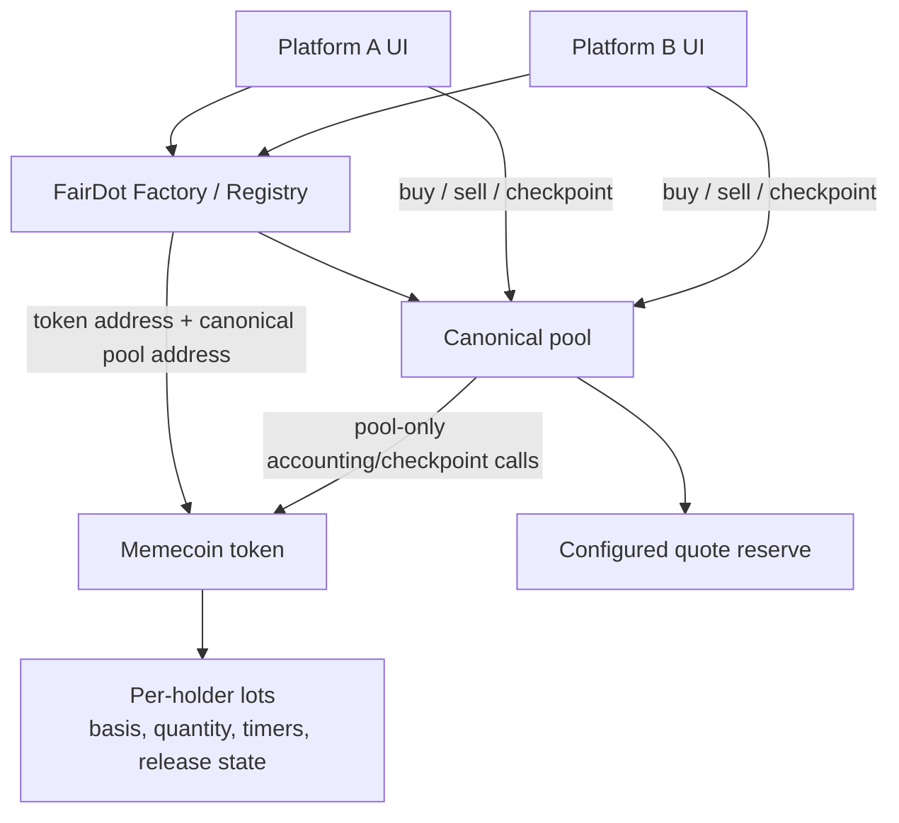

# FairDot — Target Architecture & Transaction Flows

## Scope and implementation status

This document describes the architecture implemented in the current repository and covered by local regression tests. It does not claim a network deployment, independent audit, or production readiness.

FairDot is not one memecoin or one website. The repository includes FairDot Factory/Registry contracts that create one token and one canonical pool for each memecoin. Once a shared Factory is deployed, independent platforms can read the same Registry and call the identical token/pool addresses. Platform identity cannot be enforced on-chain; any interface that calls a canonical pool is subject to its rules. No network deployment is claimed here.

> FairDot is designed to make memecoin exit rules more transparent and reduce the impact of large sell orders through one configured pool. It does not guarantee stable prices, recovery of the same quote value as a holder’s cost basis, or profit for every holder.

## 1. Target component model



The Registry identifies the canonical token/pool pairing for each instance. It is a discovery and address-consistency mechanism; it cannot establish which user interface a holder used. Market enforcement is intended to happen at the token/pool boundary, where external AMM pool/router contract routes are rejected. EOA-to-EOA transfers remain allowed and carry or split the associated lot accounting.

## 2. Target responsibilities

### Factory / Registry

- Create or record one token and one canonical pool per memecoin instance.
- Publish the canonical addresses for independent platforms to read.
- Make no claim that the UI/platform identity is enforced by the chain.

### Token

- Maintain tracked per-lot amounts, actual quote-paid cost basis, entry price, checkpoint/timer state, and released/locked profit state.
- Keep untracked inventory distinct; gifts and airdrops do not obtain purchase basis.
- Carry and proportionally split lot accounting on EOA-to-EOA transfers without merging lots with different timers.
- Apply FIFO, oldest eligible lot first, for sales.
- Accept the token-side checkpoint only from its canonical pool.
- Enforce the v1 immutability and supported-route rules in the target design.

### Canonical pool

- Record actual quote paid and tracked tokens received for purchases.
- Supply the observations used for 24-hour quote VWAP and minimum-volume qualification.
- Expose a holder-called `checkpointLock()` entry point and alone invoke the token checkpoint.
- Evaluate sale eligibility and automatically create/advance/cancel large-sale schedules according to target rules.
- Enforce the configured one-pool market path and account for quote reserve at schedule start.

These are intended responsibilities; exact contract boundaries and APIs remain subject to code review and tests.

## 3. Target state model

| State concept | Purpose |
| --- | --- |
| Registry entry | Canonical token and pool addresses for one memecoin instance. |
| Position lot | Tracked token quantity, quote actually paid, derived entry price, UTC-day grouping, checkpoint/sealed status, and timer/release state. |
| Untracked balance | Inventory without pool-recorded purchase cost, including gifts and airdrops. |
| 24-hour observations | Pool price and quote-volume samples used to calculate VWAP and compare observed quote volume with the minimum. |
| Initial quote seed and fixed inputs | Seed and configured percentage/absolute tPOT volume thresholds, selected before deployment. |
| Sale schedule | Fixed token quantity, number/size of parts, interval, progress, and last successful installment time. |
| Emergency-mode snapshot | Entry time, tracked-balance basis for the cap, and last valid price used explicitly for principal calculations. |

## 4. Position accounting and checkpoint flow

A lot’s entry is quote actually paid divided by tracked tokens received. A holder’s consecutive buys on the same UTC day may merge only into that holder’s latest open purchase lot. Checkpointing seals a lot; transferred lots are not merge candidates, and a later purchase forms a new lot. On partial transfer, the lot’s basis, timer, and accounting are split proportionally. Distinct timers are retained rather than merged. FIFO determines which eligible lot is consumed first on a sale.

The target checkpoint flow is:

```text
Holder -> canonical pool.checkpointLock()
  1. Pool identifies the caller's position and current pool price/volume observations.
  2. Pool checks that 24-hour quote volume meets
     max(configured percentage × initial quote seed, configured absolute tPOT).
  3. Pool checks whether the applicable lot's VWAP / entry is at least 5×.
  4. Pool alone calls the token checkpoint for the holder's eligible position.
  5. The checkpoint seals the applicable lot and records the lock/release state.
```

The holder may initiate this operation separately for themself. A sell attempt also checkpoints the caller before sale eligibility is evaluated; if the requested amount is not eligible, the pool defers the sale without reverting the checkpoint. At the volume threshold, a 5× ratio locks profit and releases it linearly at 10% per day for ten days. A fresh price below 5× releases remaining profit when observed through a state-changing holder action; previously released profit never re-locks.

If no trade occurs for more than 24 hours, the profit-release clock pauses while previously released profit remains eligible. After more than 7 days without a trade, `STALE_EMERGENCY_MODE` checkpoints still-open lots against the last valid price, keeps profit locked, and explicitly uses that price for principal calculations. The emergency withdrawal limit is 10% of tracked balance at emergency entry per rolling 24 hours; unused quota does not accrue. Eligibility is not guaranteed execution or payment.

## 5. Sale and installment flow

At schedule start, the full requested token quantity—including principal and profit—is evaluated using its estimated quote output divided by the pool quote reserve at that moment. The target schedule bands are:

| Full request estimate / quote reserve | Target handling |
| --- | --- |
| `≤ 10%` | One part attempted immediately; 8-hour address-based cooldown after success. |
| `> 10%` through `30%` | Three parts, 8 hours apart. |
| `> 30%` | Ten parts, 24 hours apart. |

The first part is attempted immediately. Installment quantities are fixed in token units, with rounding remainder assigned to the final part. Each part rechecks eligibility. An ineligible part waits; the next interval begins only after a successful installment. Other sales are blocked while the schedule is active. The holder may cancel remaining installments, but cooldown since the last successful installment persists. A successful one-part sale at or below 10% also starts an 8-hour cooldown for that address. Later installments require holder transactions; the target has no keeper.

An automatic per-holder schedule is not a global queue and cannot ensure liquidity, price, or quote proceeds. Schedule mechanics and calculations must be verified in the implementation and tests.

## 6. Launch, immutability, and migration

The target v1 fixes its numeric inputs after the initial quote seed is chosen and before deployment. Once trading starts, the canonical pool and v1 parameters are immutable. A rules change requires a new token/contract and voluntary migration, not an in-place parameter update. Team allocation follows separate published vesting and is not sellable through the pool in v1.

## 7. Trust boundaries and non-goals

- Pool observations supply the VWAP and volume signal; they are not an independent oracle or manipulation-proof.
- Platform identity cannot be enforced on-chain, although all interfaces using a canonical pool encounter the same pool rules.
- OTC/off-chain trades, price losses, and unregistered cross-chain representations are not prevented.
- V1 does not include a global queue, KYC/anti-sybil, LP lock, keeper, or a guarantee against rug pulls.
- A one-pool design does not guarantee buyers, sufficient quote liquidity, successful execution, or return of cost basis in quote currency.

## Disclaimer

FairDot is an experimental market-mechanics design. Eligibility rules do not guarantee payout, a stable price, recovery of cost basis, or profit. The architecture requires implementation verification, testing, and independent security review before any use with assets of value.
